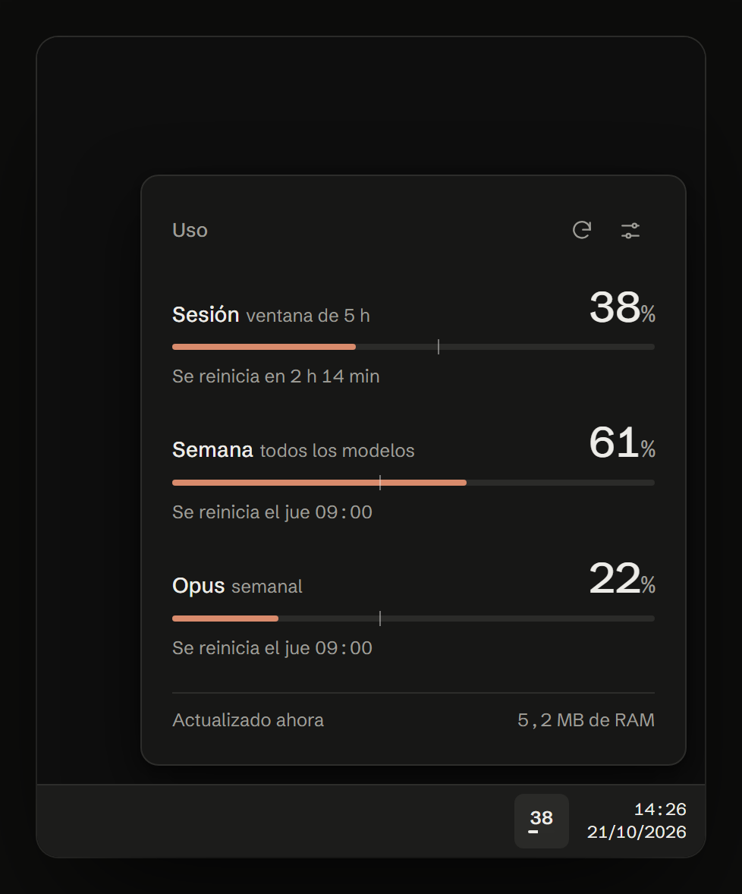
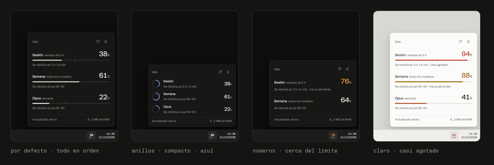

# Tally

Tu límite de Claude en la bandeja de Windows: la sesión de 5 horas, la semana (todos los modelos) y la semana de Opus, a un clic.

**[Descargar](https://github.com/wllmvg/usage-for-claude/releases/latest/download/Tally-Setup-0.1.0.exe)** · [Web](https://wllmvg.github.io/usage-for-claude/) · Windows 10 y 11, x64

<p align="center"></p>

- Icono con tu porcentaje y popup con barras, anillos o solo números.
- Casi monocromo hasta que cruzas un umbral; entonces cambia de color y Windows te avisa una vez.
- Unos 5 MB de RAM en reposo, un ejecutable de 388 KB y ninguna dependencia.
- Sin telemetría: solo habla con `api.anthropic.com`.



## Instalación

1. Descarga `Tally-Setup-0.1.0.exe` y ábrelo.
2. Si Windows muestra «Windows protegió su PC», pulsa **Más información** → **Ejecutar de todas formas**. El ejecutable no está firmado.
3. Elige la carpeta y si quieres que se abra al iniciar Windows. No pide permisos de administrador.
4. Inicia sesión en Claude Code, si no lo has hecho:

   ```
   claude
   /login
   ```

   Elige tu cuenta de Claude (suscripción), no una API key. Solo hace falta una vez. Si la sesión caduca, Tally te lo dirá; repite `/login`.

Clic en el icono para ver tu uso. El engranaje del popup abre los ajustes; clic derecho en el icono, para salir.

Para desinstalarlo: **Configuración → Aplicaciones → Aplicaciones instaladas → Tally**.

## Cómo funciona

```
~/.claude/.credentials.json  →  tally.exe  →  api.anthropic.com/api/oauth/usage  →  bandeja
```

- Lee la sesión que Claude Code guarda en tu equipo. La lee y nada más: no la renueva, no la copia y no la envía a ningún sitio salvo a `api.anthropic.com`.
- Consulta cada 5 minutos. Si el servidor responde 429, espera lo que pida antes de volver a consultar.
- Los ajustes se guardan en `%APPDATA%\Tally\config.json`.

Necesitas **Claude Code** con la sesión iniciada en el mismo equipo. Claude Desktop y la web no sirven, porque no dejan la sesión en ese archivo.

## Compilar

Rust con la toolchain `stable-x86_64-pc-windows-gnu`; no requiere Visual Studio.

```powershell
$env:CARGO_TARGET_DIR = "$env:LOCALAPPDATA\monitor-uso-target"   # si la ruta del proyecto tiene acentos
cargo test
cargo build --release
```

Instalador, con [Inno Setup 6](https://jrsoftware.org/isinfo.php) (`winget install JRSoftware.InnoSetup`):

```powershell
& "$env:LOCALAPPDATA\Programs\Inno Setup 6\ISCC.exe" installer\tally.iss   # -> dist\Tally-Setup-0.1.0.exe
```

Web, con React y Vite:

```powershell
npm --prefix web install
npm --prefix web run dev
```

| Ruta | Qué hay |
|---|---|
| `src/` | La app: ventana y bandeja (`main.rs`), dibujo (`draw.rs`), consulta de uso (`usage.rs`), ajustes (`config.rs`) |
| `installer/` | Script de Inno Setup e imágenes del asistente |
| `web/` | Web de descarga |

## Aviso

Tally no es un producto oficial de Anthropic ni está afiliado a Anthropic. La consulta de uso no está documentada y puede cambiar o dejar de funcionar sin aviso. Úsalo con tu propio criterio.

## Licencia

[MIT](LICENSE)
